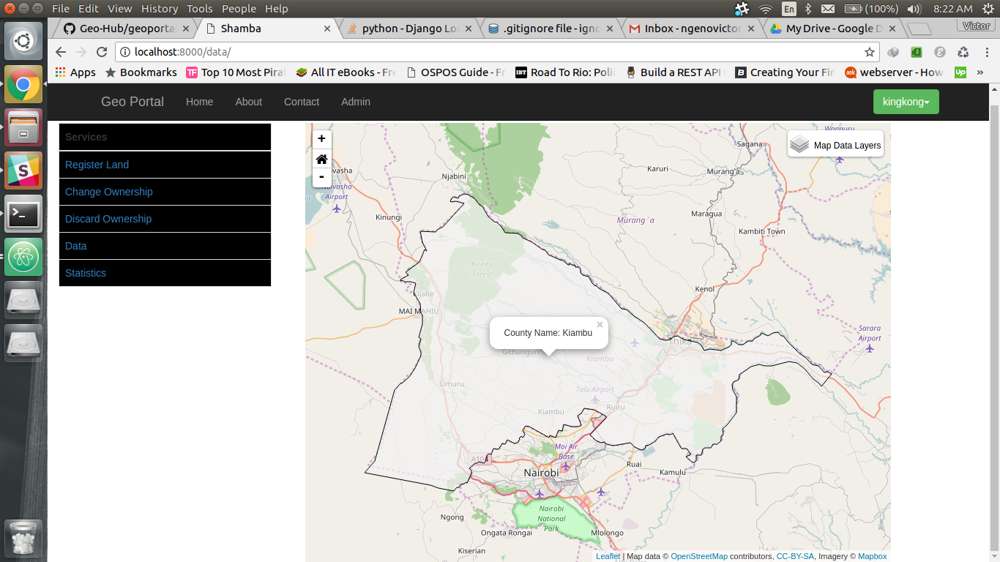
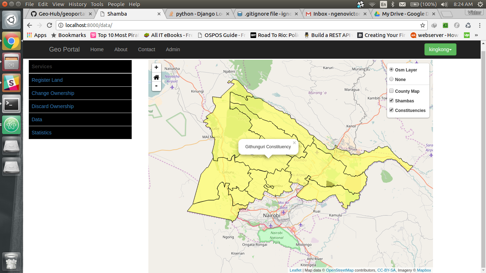
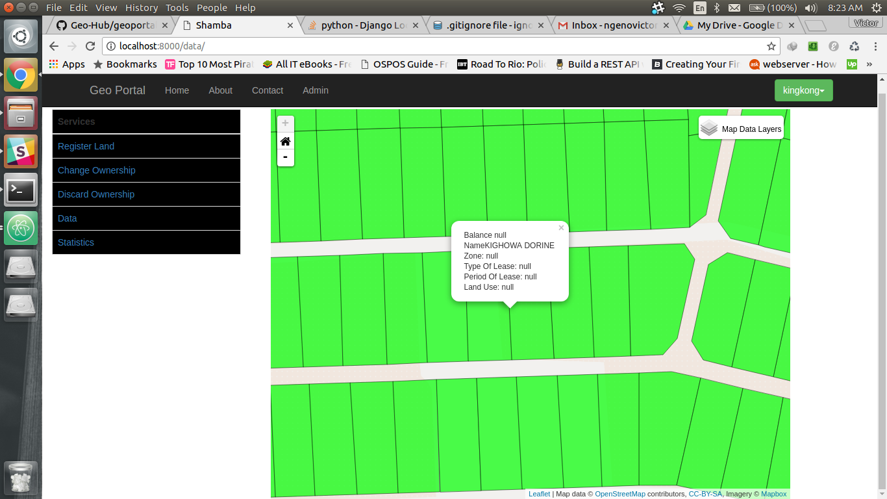

# GeoPortal

## The GeoHub Team

### Objectives
1. Demonstrate a land information systems
2. Demonstrate different access levels for land information. This ensures subsets of
   information can be accessible to the public while others by admins only.
4. Demonstrate GIS can be used to assess quality and attributes of land before purchasing.

_To demo different access levels admin can log in and out and not that the names of land owners toggles visibility_

### _Presented at the 2015 Jkuat Tech Expo_

#### _Won most popular award_

The app is up at [https://geoportal.victorngeno.com](https://geoportal.victorngeno.com)

See the [Geo part here](https://geoportal.victorngeno.com/data/)

##### Pre requisites
1. Docker installation. Install from https://docs.docker.com/engine/install/
##### _Setup Instructions_
These assume unix commands ie Ubuntu/Mac. For windows users, might need to substitute with relevant commands.
These are run in the terminal.
1. cd into your projects directory.
2. Clone this repo `git clone https://github.com/Geo-Hub/geoportal.git`
3. cd into the newly created folder `cd geoportal`
4. Run `docker compose -f compose.local.yaml watch` (no `.env` needed; it uses dev defaults and prints emails to the console)
5. Load the webserver from [http://localhost:8000](http://localhost:8000)

The GIS data in `web/data.zip` is mounted into the container (not baked into the image) and loaded into any empty tables on startup, so the first run takes a little longer.

##### _Production_
`docker compose -f compose.prod.yaml up -d --build` on the server. It expects the server's external Traefik on the
`traefik-proxy` network (with the `https` entrypoint), routes `geoportal.victorngeno.com`, and reads a `.env` copied
from `.env.sample`. PostGIS sits on an internal-only network.

#### Contributors (Team GeoHub)

1. [Ng'eno Victor](https://github.com/ngenovictor)
2. [Nombu Murage](https://github.com/nombumurage)
3. Sophia Njeri
4. [Thomas Muteti](https://github.com/Thom03)
5. James Mwangi

#### Screen Shots

1. Kiambu County loaded on the data page
    
2. Kiambu constituency loaded on the data page
    
3. Farms (Shambas) loaded on the data page
    
